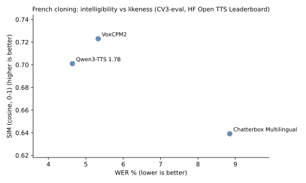
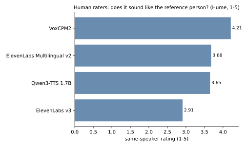
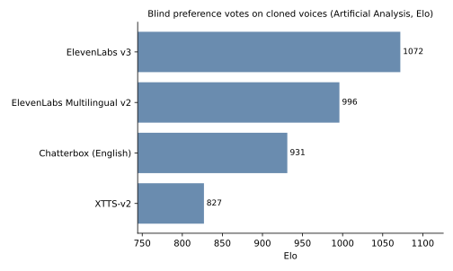

# Choosing a cloning backend: published benchmarks

How the voice-cloning backends voxy wraps compare on published, objective measures, with a link to every number's source. Data retrieved 2026-10-20; it lives in `voxy/data/benchmarks.json`, and the tables and charts below are generated from it (see "Keeping this up to date").

## In short

- **Voice likeness, judged by people:** VoxCPM2 leads the one human-rated cloning leaderboard (Hume, 1st of 13). ElevenLabs Multilingual v2 is mid-table and Qwen3-TTS close behind it. ElevenLabs v3 is last: raters judged 28% of its clips to be a different person [3].
- **French, measured independently:** on CV3-eval French with cloning, Qwen3-TTS is the most intelligible and VoxCPM2 the most alike; Chatterbox Multilingual trails on both [2]. No study puts ElevenLabs, F5-TTS or XTTS-v2 on the same French test.
- **Blind preference on cloned English voices:** ElevenLabs v3 > Multilingual v2 > Chatterbox > XTTS-v2 (Artificial Analysis); Qwen3-TTS, VoxCPM2 and F5-TTS are not listed [4].
- **Cost, licence, watermark:** Qwen3-TTS, VoxCPM2 (Apache-2.0) and Chatterbox (MIT) are free for any use. Chatterbox and ElevenLabs embed an inaudible watermark; Qwen3-TTS and VoxCPM2 do not. F5-TTS and XTTS-v2 weights are non-commercial. ElevenLabs bills 1 credit per character on both models.
- **Trade-off:** for French, start with Qwen3-TTS (stability) and VoxCPM2 (likeness), and judge by ear. ElevenLabs is the fast, paid option; v3 is the more expressive, v2 the more faithful to the voice.

## The charts

<!-- voxy-benchmarks:french-tradeoff -->

<!-- /voxy-benchmarks -->

<!-- voxy-benchmarks:human-likeness -->

<!-- /voxy-benchmarks -->

<!-- voxy-benchmarks:cloned-voice-arena -->

<!-- /voxy-benchmarks -->

## How to read the numbers

- **WER / CER** (word / character error rate, %, lower is better): an ASR model transcribes the output and is compared with the input text. It measures intelligibility and robustness, not likeness; real recordings score about 2% on Seed-TTS test-en, so 1–2% is near the floor.
- **SIM** (speaker similarity, cosine 0–1, higher is better): how close the output's speaker embedding is to the reference's. Values from different embedding models (WavLM, ECAPA, TitaNet, ERes2Net) are not comparable.
- **Human ratings** (MOS, same-speaker 1–5) are comparable only within one study. **Elo** is fitted from blind pairwise votes and is comparable only within one arena; most arenas use each vendor's own voices, which tests naturalness, not cloning.
- **Self-reported vs independent:** in the tables, `(S)` marks a number the model's developer measured. Unmarked numbers come from a third party, which may still be a competitor (every ElevenLabs number comes from a competitor's paper).
- **Comparable numbers come from one source.** Papers use different test subsets, ASR models and text normalisation; the HF Open TTS Leaderboard runs every model through one pipeline, which is why the charts prefer it.

## The tables

Each cell links to its source; several sources are separated by `·`; `—` means no source reports it.

### French

<!-- voxy-benchmarks:french -->
| Model | CV3-eval: French (WER %) | CV3-eval: French (SIM (cosine, 0-1)) | MiniMax multilingual test: French (WER %) | MiniMax multilingual test: French (SIM (cosine, 0-1)) |
|---|---|---|---|---|
| ElevenLabs Multilingual v2 | — | — | [5.216](https://arxiv.org/abs/2505.07916) | [0.535](https://arxiv.org/abs/2505.07916) |
| ElevenLabs v3 | [9.31](https://arxiv.org/abs/2607.23938) | — | [2.34](https://arxiv.org/abs/2603.25551) | — |
| Qwen3-TTS 1.7B | [4.64](https://huggingface.co/spaces/hf-audio/open_tts_leaderboard) · [9.05](https://arxiv.org/abs/2607.23938) (S) | [0.701](https://huggingface.co/spaces/hf-audio/open_tts_leaderboard) | [2.858](https://arxiv.org/abs/2601.15621) (S) | [0.714](https://arxiv.org/abs/2601.15621) (S) · [0.628](https://arxiv.org/abs/2606.06928) |
| VoxCPM2 | [9.85](https://arxiv.org/abs/2606.06928) (S) · [5.33](https://huggingface.co/spaces/hf-audio/open_tts_leaderboard) · [10.3](https://arxiv.org/abs/2607.23938) | [0.723](https://huggingface.co/spaces/hf-audio/open_tts_leaderboard) | [4.534](https://arxiv.org/abs/2606.06928) (S) | [0.735](https://arxiv.org/abs/2606.06928) (S) |
| Chatterbox Multilingual | [8.85](https://huggingface.co/spaces/hf-audio/open_tts_leaderboard) | [0.6391](https://huggingface.co/spaces/hf-audio/open_tts_leaderboard) | — | — |
<!-- /voxy-benchmarks -->

### Human ratings and arenas

<!-- voxy-benchmarks:human -->
| Model | Hume Voice Replication Leaderboard (overall, 13 models) (same-speaker rating (1-5)) | Hume Voice Replication Leaderboard (overall, 13 models) (different-person %) | Artificial Analysis Controlled Voice arena (8 cloned EN voices, 44 models) (Elo) | TTS Arena V2 (TTS-AGI, 39 listed) (Elo) |
|---|---|---|---|---|
| ElevenLabs Multilingual v2 | [3.68](https://huggingface.co/spaces/HumeAI/voice-replication-leaderboard) | [6.03](https://huggingface.co/spaces/HumeAI/voice-replication-leaderboard) | [996](https://artificialanalysis.ai/text-to-speech/leaderboard/controlled-voice) | [1504](https://huggingface.co/spaces/TTS-AGI/TTS-Arena-V2) |
| ElevenLabs v3 | [2.91](https://huggingface.co/spaces/HumeAI/voice-replication-leaderboard) | [27.94](https://huggingface.co/spaces/HumeAI/voice-replication-leaderboard) | [1072](https://artificialanalysis.ai/text-to-speech/leaderboard/controlled-voice) | [1496](https://huggingface.co/spaces/TTS-AGI/TTS-Arena-V2) |
| Qwen3-TTS 1.7B | [3.65](https://huggingface.co/spaces/HumeAI/voice-replication-leaderboard) | [9.21](https://huggingface.co/spaces/HumeAI/voice-replication-leaderboard) | — | — |
| VoxCPM2 | [4.21](https://huggingface.co/spaces/HumeAI/voice-replication-leaderboard) | [1.9](https://huggingface.co/spaces/HumeAI/voice-replication-leaderboard) | — | — |
| Chatterbox (English) | — | — | [931](https://artificialanalysis.ai/text-to-speech/leaderboard/controlled-voice) | [1476](https://huggingface.co/spaces/TTS-AGI/TTS-Arena-V2) |
| XTTS-v2 | — | — | [827](https://artificialanalysis.ai/text-to-speech/leaderboard/controlled-voice) | — |
<!-- /voxy-benchmarks -->

### Seed-TTS-eval (English and Chinese)

<!-- voxy-benchmarks:seed -->
| Model | Seed-TTS-eval test-en (WER %) | Seed-TTS-eval test-en (SIM (cosine, 0-1)) | Seed-TTS-eval test-zh (CER %) | Seed-TTS-eval test-zh (SIM (cosine, 0-1)) |
|---|---|---|---|---|
| Qwen3-TTS 1.7B | [1.24](https://arxiv.org/abs/2601.15621) (S) · [1.23](https://arxiv.org/abs/2606.06928) · [1.54](https://arxiv.org/abs/2604.00688) · [1.46](https://arxiv.org/abs/2605.20830) · [0.77](https://huggingface.co/spaces/hf-audio/open_tts_leaderboard) | [0.717](https://arxiv.org/abs/2606.06928) · [0.708](https://arxiv.org/abs/2604.00688) · [0.715](https://arxiv.org/abs/2605.20830) · [0.717](https://huggingface.co/spaces/hf-audio/open_tts_leaderboard) | [0.77](https://arxiv.org/abs/2601.15621) (S) · [1.22](https://arxiv.org/abs/2606.06928) · [1.15](https://arxiv.org/abs/2604.00688) · [0.68](https://huggingface.co/spaces/hf-audio/open_tts_leaderboard) | [0.77](https://arxiv.org/abs/2606.06928) · [0.766](https://arxiv.org/abs/2604.00688) · [0.7686](https://huggingface.co/spaces/hf-audio/open_tts_leaderboard) |
| VoxCPM2 | [1.84](https://arxiv.org/abs/2606.06928) (S) · [0.97](https://huggingface.co/spaces/hf-audio/open_tts_leaderboard) | [0.753](https://arxiv.org/abs/2606.06928) (S) · [0.7272](https://huggingface.co/spaces/hf-audio/open_tts_leaderboard) | [0.97](https://arxiv.org/abs/2606.06928) (S) · [1.35](https://huggingface.co/spaces/hf-audio/open_tts_leaderboard) | [0.795](https://arxiv.org/abs/2606.06928) (S) · [0.8267](https://huggingface.co/spaces/hf-audio/open_tts_leaderboard) |
| Chatterbox (English) | [2.2](https://arxiv.org/abs/2605.30748) (S) · [1.07](https://huggingface.co/spaces/hf-audio/open_tts_leaderboard) | [0.685](https://arxiv.org/abs/2605.30748) (S) · [0.5951](https://huggingface.co/spaces/hf-audio/open_tts_leaderboard) | — | — |
| F5-TTS | [1.83](https://arxiv.org/abs/2410.06885) (S) · [2.0](https://arxiv.org/abs/2509.24650) · [1.85](https://arxiv.org/abs/2604.00688) · [2.04](https://arxiv.org/abs/2605.20830) | [0.67](https://arxiv.org/abs/2410.06885) (S) · [0.67](https://arxiv.org/abs/2509.24650) · [0.664](https://arxiv.org/abs/2604.00688) · [0.671](https://arxiv.org/abs/2605.20830) | [1.56](https://arxiv.org/abs/2410.06885) (S) · [1.53](https://arxiv.org/abs/2509.24650) · [1.53](https://arxiv.org/abs/2604.00688) | [0.76](https://arxiv.org/abs/2410.06885) (S) · [0.76](https://arxiv.org/abs/2509.24650) · [0.75](https://arxiv.org/abs/2604.00688) |
| VoxCPM (v1, 0.5B) | [1.85](https://arxiv.org/abs/2509.24650) (S) · [1.92](https://arxiv.org/abs/2604.00688) · [1.98](https://arxiv.org/abs/2605.20830) | [0.729](https://arxiv.org/abs/2509.24650) (S) · [0.731](https://arxiv.org/abs/2604.00688) · [0.73](https://arxiv.org/abs/2605.20830) | [0.93](https://arxiv.org/abs/2509.24650) (S) · [0.99](https://arxiv.org/abs/2604.00688) | [0.772](https://arxiv.org/abs/2509.24650) (S) · [0.772](https://arxiv.org/abs/2604.00688) |
<!-- /voxy-benchmarks -->

### Practical facts

<!-- voxy-benchmarks:facts -->
| Model | Licence | French | Languages | Size | Runs | Price | Watermark |
|---|---|---|---|---|---|---|---|
| ElevenLabs Multilingual v2 | proprietary service | yes | 29 | — | cloud API | about $0.08 per 1,000 characters (1 credit per character) | inaudible, embedded (ElevenLabs Audio Detector) |
| ElevenLabs v3 | proprietary service | yes | 70 | — | cloud API | about $0.08 per 1,000 characters (1 credit per character) | inaudible, embedded (ElevenLabs Audio Detector) |
| Qwen3-TTS 1.7B | Apache-2.0 | yes | 10 | 1.7B | local, CPU or GPU | free (local) | none documented or in code |
| VoxCPM2 | Apache-2.0 | yes | 30 | 2B | local, CPU or GPU (about 8 GB VRAM) | free (local) | none documented or in code |
| Chatterbox (English) | MIT | no | 1 | 0.5B | local, CPU or GPU | free (local) | Perth, always on |
| Chatterbox Multilingual | MIT | yes | 23 | 0.5B | local, CPU or GPU | free (local) | Perth, always on |
| F5-TTS | code MIT, weights CC-BY-NC-4.0 (non-commercial) | no | 2 | 336M | local, CPU or GPU | free (local), non-commercial | none |
| XTTS-v2 | Coqui Public Model License (non-commercial) | yes | 17 | about 0.5B | local, CPU or GPU | free (local), non-commercial | none |
<!-- /voxy-benchmarks -->

## Caveats

- Vendor claims dominate the paper numbers; independent results disagree with them (Qwen3-TTS test-zh CER: 0.77 self-reported, 0.68 to 1.22 elsewhere).
- The VoxCPM2 report gives Qwen3-TTS a French SIM of 0.628 on the MiniMax test; that is MiniMax's own value and contradicts Qwen's 0.714, so it is probably a copying error.
- Only two boards test cloning itself: Artificial Analysis Controlled Voice (English) and Hume.
- French evidence is thin: no French human evaluation exists for any of these models, F5-TTS has no French result (its official weights are English and Chinese only), and ElevenLabs v2's French numbers rest on one competitor's two-speaker test.
- Speed numbers in papers are on datacenter GPUs and vary with batch size and engine; on a CPU every local model here runs several times slower than real time.

## Keeping this up to date

Edit `voxy/data/benchmarks.json`: add a row per published number (`model` is a voxy backend id such as `qwen3tts` or `elevenlabs/eleven_v3`; keep `source_url`, `self_reported` and `retrieved`), or change a model's facts. Then regenerate the tables and charts:

```bash
python -m voxy benchmarks misc/docs/benchmarks.md
```

New tables or charts are entries in `TABLES` and `CHARTS` in `voxy/benchmarks.py`, placed in this page with a `<!-- voxy-benchmarks:NAME -->` block.

## References

1. Full source list: every row of `voxy/data/benchmarks.json` carries its `source_url`.
2. [HF Open TTS Leaderboard](https://huggingface.co/spaces/hf-audio/open_tts_leaderboard)
3. [HumeAI Voice Replication Leaderboard](https://huggingface.co/spaces/HumeAI/voice-replication-leaderboard)
4. [Artificial Analysis Controlled Voice Leaderboard](https://artificialanalysis.ai/text-to-speech/leaderboard/controlled-voice)
5. [TTS Arena V2](https://huggingface.co/spaces/TTS-AGI/TTS-Arena-V2)
6. [Qwen3-TTS Technical Report](https://arxiv.org/abs/2601.15621) · [VoxCPM2 Technical Report](https://arxiv.org/abs/2606.06928) · [F5-TTS](https://arxiv.org/abs/2410.06885) · [XTTS](https://arxiv.org/abs/2406.04904) · [MiniMax-Speech](https://arxiv.org/abs/2505.07916)
7. [ElevenLabs watermarking](https://elevenlabs.io/docs/help-center/legal/audio-detector/what-is-watermarking-and-why-is-eleven-labs-using-it) · [ElevenLabs API pricing](https://elevenlabs.io/pricing/api) · [ElevenLabs models](https://elevenlabs.io/docs/overview/models)
